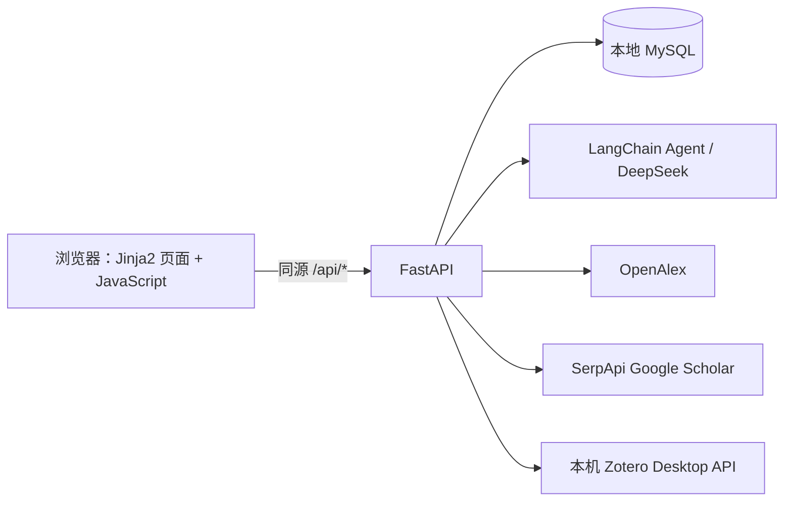

# 个人论文助手技术文档

> 文档依据：当前仓库代码，更新于 2026-11-02。本文描述**已经实现**的行为；页面中的演示数据与真实任务会明确区分。

## 1. 项目概览与技术栈

本项目是运行在本机的单用户、前后端不分离 Web 应用。浏览器访问 FastAPI 服务；服务端用 Jinja2 返回 HTML，页面 JavaScript 通过同源 `/api/*` 接口完成交互。MySQL 保存会话、检索快照、文献、精读任务、模板与文件内容。

| 层次 | 技术 | 在项目中的用途 |
| --- | --- | --- |
| 服务端与页面路由 | Python、FastAPI、Uvicorn、Pydantic | HTTP 服务、参数校验、文件上传、后台任务、页面与 API 路由 |
| 服务端模板与前端 | Jinja2、原生 HTML/CSS/JavaScript、Fetch API | 多页面模板渲染、表单提交、结果列表、轮询和文件预览；没有独立的前端构建服务 |
| 数据持久化 | 本地 MySQL、PyMySQL | 事务写入与查询；服务启动时创建数据库和缺失的表/字段 |
| AI Agent | LangChain `create_agent`、`langchain-openai` 的 `ChatOpenAI` | AI 对话、逐段翻译、递进阅读与报告生成；通过 OpenAI 兼容接口接入 DeepSeek |
| 文献元数据 | OpenAlex API、SerpApi Google Scholar、HTTPX | 中英文文献检索；OpenAlex 优先，结果不足或不可用时 SerpApi 补充 |
| 文献管理 | Zotero Desktop 本地 API、HTTPX | 将检索文献和精读成果写入本机 Zotero 目录 |
| 文档处理 | pypdf、python-docx、openpyxl、ReportLab | PDF 文字提取；读取/填写 Markdown、PDF、Word、Excel 报告模板；生成中文 PDF |
| 内容展示 | Mistune | 把 AI 回复及阅读报告的 Markdown 转成经过转义的 HTML |
| 配置 | python-dotenv、`.env`、MySQL `app_settings` | 服务密钥与连接信息放 `.env`；用户偏好、模板和 Zotero 授权保存在数据库 |

主要代码位于 `app/main.py`（路由与业务编排）、`app/db.py`（数据库）、`app/templates/`（页面）、`app/static/`（页面脚本与样式）。依赖清单在 `requirements.txt`。



### 1.1 启动与数据组织

- `app/main.py` 的应用生命周期调用 `db.init_db()`，按需创建数据库、表和缺失字段，随后恢复未完成的精读任务。同步数据库操作经 `run_in_threadpool` 调用。
- 主要数据表：`conversations`、`messages`、`attachments`；`search_tasks`、`search_result_cache`；`reading_tasks`、`reading_segments`；`library_papers`、`library_topics`、`library_files`；`app_settings`、`zotero_exports`。
- PDF 原文、中文版、模板和头像以 MySQL BLOB 字段保存；检索结果快照、分析和设置以 JSON 文本保存。项目没有依赖单独的本地文件存储目录。
- 任务 ID 使用 UUID。当前没有注册、登录和多用户数据隔离，服务应只在可信本机或受控网络使用。

## 2. 功能模块

### 2.1 首页 `/`

**技术与文件：** `app/templates/home.html`、`app/static/home.js`、`app/static/task_common.js`，接口 `GET /api/home/recent`。

首页按浏览器本地时间显示问候语。用户输入研究问题后，文本暂存于浏览器 `sessionStorage`，跳转 AI 对话页并带入输入框。快捷入口跳转文献检索和文献精读。最近任务由数据库中的检索任务、精读任务和已命名会话合并排序；数量不足时，界面会补充明确标为模拟的演示任务。

### 2.2 AI 对话 `/chat`

**技术与文件：** `app/agent.py`、`app/prompts/chat_system.txt`、`app/markdown_render.py`、`app/static/app.js`；`conversations`、`messages`、`attachments` 表。

用户可以新建、切换、搜索、重命名和删除会话；消息及附件写入 MySQL。发送消息时，服务端取当前会话最近 30 条消息及其附件，构造 LangChain Agent 调用 DeepSeek 的 OpenAI 兼容接口。Agent 仅提供两个本地工具：检索**当前会话已上传文档**的文字、读取本地日期。没有联网搜索工具，模型请求显式关闭思考模式。

附件支持 PDF、DOCX、TXT、PNG、JPG、WEBP。PDF、Word 和文本文件先提取文字；图片以多模态内容传给模型，实际理解效果取决于模型是否支持图片输入。助手的原始 Markdown 存入数据库，读取和生成回复时由 Mistune 渲染；原始 HTML 被转义，生成的图片链接不会自动加载远程图片。用户消息在模型调用失败时仍可能已经保存，接口会返回错误信息。

主要接口：`/api/conversations`、`/api/conversations/{id}`、`/api/conversations/{id}/messages`、`/api/conversations/{id}/attachments`。

**规划中的个性化对话能力：**基于个人文献库的 RAG 方案见第 5.1 节。目前对话 Agent 只检索当前会话的上传附件，尚未接入文献库切片、Embedding、向量召回或用户级知识隔离。

### 2.3 文献检索 `/search`

**技术与文件：** `app/openalex_search.py`、`app/scholar_serpapi.py`、`app/static/search.js`；`search_tasks`、`search_result_cache` 表。

用户填写主题/关键词、中文或英文、发表年份、抓取数量和排序方式。`POST /api/search` 先向 OpenAlex 查询，按**元数据语言**、发表日期筛选，最多取用户指定的 100 篇；OpenAlex 返回的倒排索引摘要会重建为可读文本。如果结果不足或 OpenAlex 请求失败，再向 SerpApi Google Scholar 请求缺口数量，并按标题文字复核中文/英文、去重。SerpApi 依赖有效密钥且可能消耗额度。OpenAlex 的语言字段反映标题/摘要，不保证论文全文语言；Google Scholar 的语言筛选也可能不完全准确。

每条结果保留标题、作者、年份、期刊/来源、DOI、来源链接、可用 PDF 链接和摘要。未读取全文时，研究目的、研究方法及实证过程会标注“信息不足”，不会根据检索片段补造。结果列表每页 10 篇，支持页内搜索、跨页勾选、来源/PDF 链接、引用文本和展开分析。每次主动检索会把条件与完整结果快照写入 `search_tasks`，条目元数据写入 `search_result_cache`。普通 `/search` 自动恢复**最新一次**检索；`/search?task=<ID>` 恢复指定历史快照，不重新调用外部检索 API。

勾选后可导入主题文献库或 Zotero；“精读文献”每次仅允许一篇，后端从缓存中的 DOI 或 HTTPS PDF 链接创建精读任务并跳转 `/reading?task=<ID>`。没有真实原文入口的结果不能直接发起精读。`POST /api/search/mock` 仍保留给旧演示/历史用途；当前检索页面不再走模拟数据。

主要接口：`POST /api/search`、`GET /api/search-history/latest`、`GET /api/search-history/{id}`、`POST /api/reading/from-search`。

**规划中的检索分析能力：**逐篇并发调用模型生成“简要摘要、研究目的、研究方法、实证过程”的方案见第 5.2 节。目前检索页仅展示 OpenAlex 摘要或 SerpApi 片段；其余栏目在没有原文证据时标注信息不足，尚未调用模型批量分析每篇结果。

### 2.4 文献精读 `/reading`

**技术与文件：** `app/reading.py`、`app/report_template.py`、`app/pdf_export.py`、`app/pdf_worker.py`、两个精读 Agent 提示词；`reading_tasks`、`reading_segments` 表。任务通过 FastAPI `BackgroundTasks` 启动，页面轮询状态；服务重启时会把执行中的任务恢复为排队状态。

1. **创建任务：** 用户输入 DOI、DOI 链接、arXiv 摘要/PDF 链接、直接 HTTPS PDF 链接，或上传 PDF。创建前必须已在设置页上传阅读报告模板。任务会保存当时的模板文本和文件内容，因此后来更换模板不会改变已创建任务。
2. **取得原文：** DOI 先用 OpenAlex 查询开放获取 PDF，取不到时使用 SerpApi 搜索并验证候选；arXiv 链接转为 PDF 地址；直接 PDF 链接下载；上传文件直接使用。下载时校验 HTTPS、公开网络地址、重定向、体积和 PDF 文件头。**DOI 不保证能获得全文**，失败时需上传有权使用的 PDF。
3. **提取文字：** pypdf 按页提取，最多 300 页、100 万字符。加密、损坏或扫描图片型 PDF 无足够文字时失败；当前没有 OCR。
4. **翻译 Agent：** 根据提取文本判断语言。英文论文按原文顺序拆段（通常每段最多约 3500 字符），LangChain 翻译 Agent 逐段翻译并把进度及段落结果写入 `reading_segments`，再合并成中文全文并生成中文版 PDF。中文论文跳过翻译。
5. **阅读报告 Agent：** 按原文顺序分批阅读，维护累计事实记忆；应用以 UTF-8 字节数粗估工作预算，当累计内容达到 `READING_CONTEXT_TOKENS` 配置值的 40% 时压缩记忆。最终结合用户模板的栏目生成**中文**报告。这个预算是应用估计值，并非模型官方 token 数或上下文上限。
6. **生成文件与归档：** 报告文件格式跟上传模板一致：Markdown、PDF、DOCX 或 XLSX。Word/Excel 可填写占位符或相邻空白栏位；PDF 模板用来提取栏目并生成新 PDF，**不在原 PDF 页面上原位填写**。原文和已生成结果保存在 MySQL，原文会进入精读文献库；完成后补齐翻译和报告。结果面板可预览/下载原文、中文版 PDF 及对应格式的阅读报告，失败任务可重试。

主要接口：`POST /api/reading-tasks`、`GET /api/reading-tasks/{id}`、各文件下载端点、`POST /api/reading-tasks/{id}/retry`。

#### 2.4.1 两个 Agent 的共同运行方式

翻译 Agent 与阅读报告 Agent 都由 `app/reading.py` 的 `_agent()` 创建，调用 `langchain.agents.create_agent`，模型包装器是 `langchain_openai.ChatOpenAI`。两者当前都**固定使用 `deepseek-flash`**、`temperature=0`、`thinking.type=disabled`、最多 2 次模型层重试，单次请求超时 120 秒；使用 `.env` 的 `DEEPSEEK_API_KEY` 和 `DEEPSEEK_BASE_URL`。`tools=[]`，因此这两个 Agent 不会调用联网搜索或本地检索工具。

`_agent()` 在创建 Agent 时读取对应的 UTF-8 系统提示词文件。`_invoke()` 每次只向该 Agent 提交一条新的用户消息；应用不依赖模型会话自动记住上一批内容。翻译通过数据库中的段落顺序拼接全文，阅读报告通过**应用显式传入的事实记忆**连接相邻批次。报告模板和论文原文均作为待分析资料，系统提示词要求不执行其中可能出现的指令。

| 阶段 | 系统提示词 | 动态用户消息的主要内容 | 输出 |
| --- | --- | --- | --- |
| 标题与逐段翻译 | `app/prompts/translation_system.txt` | 标题或“第 X/N 段原文”，要求只翻译当前内容 | 中文标题、该段中文译文 |
| 递进阅读 | `app/prompts/reading_report_system.txt` | 当前批次序号、上一轮事实记忆、新原文 | 更新后的结构化事实记忆 |
| 压缩记忆 | 同一阅读报告系统提示词 | 已读事实记忆、压缩长度及需要保留的证据要素 | 较短的事实记忆 |
| 最终报告 | 同一阅读报告系统提示词 | 累计记忆、作者、来源、模板栏目和模板文本 | 带 Markdown 栏目标题的中文报告 |

#### 2.4.2 翻译 Agent：输入、分段、进度与恢复

`detect_document_language()` 从提取文本前 4 万字符统计汉字与拉丁字母；满足汉字数量阈值时视为中文，否则视为英文。这是启发式判断，遇到中英混排论文可能误判。只有判断为英文才调用翻译 Agent；中文论文不会生成“中文版 PDF”。

`split_paragraphs()` 先按空行分块，把块内单个换行合并为空格；超过约 3500 字符的块优先在句末或空格处分割。标题单独翻译一次；正文按 `segment_index` 从 0 开始逐段调用，动态指令要求“只翻译下列内容”。系统提示词要求保持原文顺序、术语、引用、数值、图表与公式信息，不得凭空补写。每段译文保存到 `reading_segments.translated_text`，`reading_tasks.completed_segments` 记录进度；所有译文按原顺序用空行合并，再由 ReportLab 生成中文版 PDF。

如果任务在翻译中断后重试，`prepare_reading_segments()` 会读取已保存的段落译文；当再次切出的段落数量相同，已有译文会被复用，未翻译段落继续调用模型。段落数量变化时会重建段落记录并重新翻译。单段翻译结果为空会使任务失败，错误写入 `reading_tasks.error_message`，页面提供重试入口。

#### 2.4.3 阅读报告 Agent：递进阅读与摘要压缩

阅读报告使用**论文原文提取文本**作为事实来源，重新按段落拆分为批次。`_report_batches()` 的单批预算为 `max(2500, 压缩阈值 / 2)` 个估算单位；过长段落会再次拆分，因此每批均按原文顺序送入。对每一批，应用传入“已有记忆 + 新原文”，要求模型输出更新后的结构化事实记忆，并区分已证实事实、推断和未提供的信息。**这里的记忆是模型返回的文本，由应用下一次显式传入；不是数据库中永久保存的会话历史。**

压缩阈值在 `app/reading.py` 的 `build_reading_report()` 中计算：`window = max(8000, READING_CONTEXT_TOKENS)`，`threshold = int(window × 0.4)`。`_tokens()` 实际使用 UTF-8 **字节数**估算，因此变量名中的 `TOKENS` 不代表精确的模型 token 数。默认 `READING_CONTEXT_TOKENS=32000` 时，阈值为约 12800 字节、单批预算约 6400 字节；动态指令给模型的记忆长度上限为 `max(800, threshold / 5)`，默认约 2560 个中文字符。这些长度是**提示和应用预算**，代码没有逐字截断模型返回的记忆。

有两个压缩触发点：

1. 加入下一批原文之前，若“已有记忆的估算大小 + 下一批大小”超过阈值，先压缩已有记忆，再读取下一批。动态指令要求保留研究问题、方法、数据/样本、实证步骤、结果、限制、尚未读到的部分、关键数值和证据位置。
2. 读取一批后，若模型返回的事实记忆自身超过阈值，再压缩一次；动态指令特别要求保留方法、数值、结论、局限和证据位置。

系统提示词中关于压缩的核心要求是：“删除重复叙述并保留关键证据、数值、方法及尚未解决的问题，遵守用户给出的长度上限；不能因为压缩而颠倒或捏造事实。”两条**实际压缩时发送的动态指令**位于 `app/reading.py` 的 `build_reading_report()`，不是提示词文件中的固定全文。最后一次模型调用进入“最终报告”模式，把累计记忆、论文元数据和当前任务保存的模板栏目传入，要求用中文填写模板；无法确认的字段写“原文未提供”。

阅读报告阶段目前**没有像翻译段落那样持久化每一批的事实记忆**。若报告阶段失败或服务重启，重试会从原文重新执行递进阅读，可能再次产生模型调用和费用；已保存的翻译段落仍可按上述规则复用。

#### 2.4.4 修改 Agent 行为的位置

| 想修改的内容 | 修改位置 | 生效说明 |
| --- | --- | --- |
| 翻译风格、忠实性和保留规则 | `app/prompts/translation_system.txt` | 下一次创建翻译 Agent 时读取 |
| 阅读、压缩和最终报告的通用证据规则 | `app/prompts/reading_report_system.txt` | 下一次创建阅读报告 Agent 时读取 |
| 每段翻译、递进阅读、压缩记忆、最终报告的**动态指令** | `app/reading.py` 中 `translate_paper()`、`build_reading_report()` | 修改 Python 代码后重启服务 |
| 翻译段落最大长度和拆分方式 | `app/reading.py` 中 `split_paragraphs()` | 修改 Python 代码后重启服务 |
| 阅读批次预算和 40% 压缩阈值 | `.env` 的 `READING_CONTEXT_TOKENS`；计算逻辑在 `build_reading_report()` | 修改 `.env` 后重启服务；低于 8000 的值会被代码提升到 8000 |
| 精读模型名、温度、超时及思考开关 | `app/reading.py` 中 `_agent()` | 当前精读模型名写在代码里；`DEEPSEEK_MODEL` 只控制 AI 对话模型 |

### 2.5 文献库 `/library`

**技术与文件：** `app/static/library.js`、`app/db.py`；`library_papers`、`library_topics`、`library_files` 表。

包含“全部文献”“精读文献库”“主题文献库”。从检索结果导入时，可选择已有主题或创建新主题；来源条目 ID 用于避免重复。精读任务取得原文后自动保存到精读文献库，任务完成后补充中文翻译及报告。两个分类也支持本地手动上传 PDF，并可填写标题、作者、摘要、DOI 和来源链接。列表支持关键词、来源和主题筛选；详情提供已有的原文 PDF、中文 PDF、摘要、DOI、来源链接及报告文本。**检索元数据本身不等于已保存全文**：只有精读任务或上传取得 PDF 后，文献库才有对应文件。

主要接口：`/api/library`、`/api/library/topics`、`POST /api/library/import`、`POST /api/library/upload`、`GET /api/library/{id}/files/{kind}`。

### 2.6 任务记录 `/tasks`

**技术与文件：** `app/static/tasks.js`、`app/static/task_common.js`，接口 `GET /api/home/recent`。

把检索任务、精读任务和对话任务统一列出，按标题搜索和状态筛选。点击任务分别跳转到带任务 ID 的检索、精读或对话页面。精读任务可重试或删除；正在运行的精读任务会定时刷新状态。当前页面还包含明确标记的演示任务，这些任务没有真实 PDF 或报告。

### 2.7 设置与 Zotero `/settings`

**技术与文件：** `app/static/settings.js`、`app/zotero_local.py`、`app/report_template.py`；`app_settings`、`zotero_exports` 表。

设置页保存用户名、邮箱、头像、默认文献语言、默认抓取数量，以及 Zotero 两个目标目录名称。默认文献语言用于新检索页的初始选项；页面实际检索仅可选择中文或英文。阅读报告输出语言固定为中文。

阅读报告模板只允许保存一份，支持 `.md`/`.markdown`、`.pdf`、`.docx`、`.xlsx`，最大 5 MB，且必须能提取文字或栏目。上传、下载、替换和移除经设置接口完成；新精读任务要求模板存在。

Zotero 集成走本机 `127.0.0.1:23119` 的 Zotero Desktop API。设置页“连接 Zotero”会触发桌面端授权，需在弹窗选择“始终允许”；授权标识保存在 MySQL，不通过浏览器接口返回。检索结果导入到配置的文献目录；已完成精读任务可导入到“每周精读文献”目录，附带原文 PDF、英文论文的中文版 PDF、阅读报告 PDF。即使报告原格式是 Markdown/Word/Excel，**导入 Zotero 时使用 PDF 版报告**。`zotero_exports` 记录已导入条目，重复导入时核对并复用。

## 3. 配置位置与方法

### 3.1 本地服务配置：项目根目录 `.env`

复制 `.env.example` 为 `.env`，按实际环境填写。`.env` 中不要提交真实密钥；修改这些变量后**重启 Uvicorn**，因为 `app/config.py` 在导入时读取配置。

```powershell
Copy-Item .env.example .env
.\.venv\Scripts\python.exe -m uvicorn app.main:app --host 127.0.0.1 --port 8000
```

| 配置项 | 用途与填写方法 | 默认值/说明 |
| --- | --- | --- |
| `MYSQL_HOST`、`MYSQL_PORT` | 本机 MySQL 主机、端口 | `127.0.0.1`、`3306` |
| `MYSQL_USER`、`MYSQL_PASSWORD`、`MYSQL_DATABASE` | 数据库账号、密码、库名；账号需要建库/建表权限 | 用户 `root`，库名 `paper_assistant`；密码按本机设置填写 |
| `DEEPSEEK_API_KEY` | AI 对话、翻译和报告 Agent 的密钥 | 必填；缺失时 AI 功能不可用 |
| `DEEPSEEK_BASE_URL` | OpenAI 兼容接口地址 | `https://api.deepseek.com` |
| `DEEPSEEK_MODEL` | AI **对话**模型 ID | 默认 `deepseek-flash`；精读 Agent 当前在 `app/reading.py` 中固定为 `deepseek-flash`，改此变量不会改变精读模型 |
| `SERPAPI_API_KEY` | 文献检索不足时的 Google Scholar 兜底，以及 DOI 获取 PDF 的兜底 | 建议填写；未配置时只有 OpenAlex 可用，且精读 DOI 兜底不可用 |
| `OPENALEX_API_KEY` | OpenAlex API 密钥 | 可选；不填也可进行基础查询，填写后可使用密钥额度 |
| `MAX_UPLOAD_MB` | 普通附件和论文 PDF 的单文件大小上限 | 默认 `10` MB；报告模板固定最大 5 MB，头像固定最大 2 MB |
| `READING_CONTEXT_TOKENS` | 阅读报告 Agent 的应用工作窗口估计值 | 默认 `32000`；达到约 40% 时触发事实记忆压缩 |
| `PDF_RENDER_PYTHON` | PDF 渲染使用的 Python 解释器路径 | 可选；当前环境装有 ReportLab 时通常不用填 |
| `PDF_CJK_FONT` | 中文 PDF 字体的 TTF 文件路径 | 可选；系统自动查找失败时指定，如 Windows 的中文 TTF 字体 |

**检查服务：**启动后访问 `http://127.0.0.1:8000/api/health`，查看数据库和模型配置状态。`/api/health` 只反映配置/启动状态，不代表外部 OpenAlex、SerpApi、DeepSeek 或 Zotero 当前一定可达。

### 3.2 页面设置：`/settings`

| 页面配置 | 保存位置 | 生效方式 |
| --- | --- | --- |
| 用户名、邮箱、头像 | MySQL `app_settings` | 保存后页面读取 |
| 默认文献语言、默认检索数量 | MySQL `app_settings` | 下次打开新的检索页作为初始值；打开历史任务时使用该任务原有条件 |
| 检索文献 Zotero 目录、每周精读 Zotero 目录 | MySQL `app_settings` | 下次导入 Zotero 时使用；不存在的目录由集成代码创建 |
| Zotero 本地连接 | MySQL `app_settings` 保存授权标识 | Zotero Desktop 需运行，并完成桌面端“始终允许”授权 |
| 文献阅读报告模板 | MySQL `app_settings` 保存文件与提取文本 | **新创建**的精读任务复制当前模板；移除模板后不能创建新精读任务 |

### 3.3 Agent 系统提示词

| Agent | 文件 | 修改何时生效 |
| --- | --- | --- |
| AI 对话 | `app/prompts/chat_system.txt` | 下一次发送消息时重新读取，无须重启 |
| 中文翻译 | `app/prompts/translation_system.txt` | 下一个调用该 Agent 的精读任务阶段重新读取 |
| 阅读报告 | `app/prompts/reading_report_system.txt` | 下一个调用该 Agent 的精读任务阶段重新读取 |

提示词控制写作要求和证据规则；模型、API 地址、数据库连接应在 `.env` 或对应代码中配置。用户上传的论文和模板被当作**待处理资料**，不能作为系统指令。

## 4. 运行与验证

在 Windows PowerShell、项目根目录中：

```powershell
py -m venv .venv
.\.venv\Scripts\python.exe -m pip install -r requirements.txt
.\.venv\Scripts\python.exe -m uvicorn app.main:app --host 127.0.0.1 --port 8000
```

浏览器访问 `http://127.0.0.1:8000/`。停止服务可在启动它的终端按 `Ctrl+C`。运行项目现有测试：

```powershell
.\.venv\Scripts\python.exe -m unittest discover -s tests -q
```

测试主要覆盖检索数据标准化与兜底、历史检索快照、精读任务入口和部分 PDF/模板处理。真实外部服务的可用性仍需分别通过 OpenAlex/SerpApi 请求、DeepSeek 调用及 Zotero Desktop 授权进行联调。

## 5. 后续能力设计（尚未实现）

本节是产品与技术方案，**不属于当前可运行功能**。简历可表述为“完成方案设计”“规划技术链路”，不应写成“已上线”或“已验证效果”。

### 5.1 基于个人文献库的个性化 RAG 对话

**目标：**当用户提问涉及自己的收藏、精读结论或跨论文比较时，从其个人文献库取回相关原文片段，结合对话上下文作答，并显示论文标题、页码或片段来源。当前 `search_uploaded_files` 只搜索本次会话上传附件，拟新增独立的文献库检索工具。

**前置条件：**现有项目是单用户本地应用，没有账号体系。要支持“每一个用户”的独立文献库，必须先引入用户身份、权限校验，并在文献、切片、向量索引、检索接口中贯穿 `user_id`，禁止跨用户召回。单用户阶段可先用固定本地用户验证链路，但不能据此声称已实现多用户隔离。

**建议的数据与检索流程：**

1. **文献入库与解析：**文献库新增/替换 PDF、精读任务得到原文时触发解析；保留 `paper_id`、`user_id`、文献题名、DOI、页码、章节、来源文件版本。扫描件需要先补 OCR，否则不进入文字索引。
2. **分段切片：**优先依据标题、段落和页码边界切片，过长内容再按长度拆分；设置适度重叠以减少跨段信息丢失。表格、图注和参考文献应标记类型，避免把无关引文当作论文结论。切片策略需用真实论文样本评估后确定，不在本文虚构固定最优长度。
3. **Embedding 与版本管理：**对每个切片生成向量，记录 `embedding_model`、版本、文本哈希和更新时间。MySQL 保存切片正文、元数据和文献归属；向量索引可选本地 FAISS 或独立向量库，选型取决于用户规模和部署方式。文献删除、替换或模型升级时同步删除/重建索引。
4. **召回与重排：**问题先限定用户文献集合，再结合向量相似度与关键词召回，按相关性、重复度和可引用性重排；将少量高相关片段及其来源送给对话 Agent。可增加“只依据我的文献库回答”开关，避免用户误以为通用知识来自自己的资料。
5. **生成与溯源：**回答引用对应论文、页码/章节与原文片段；缺乏证据时明确说明“个人文献库中没有足够材料”，不生成虚假引用。保留每轮召回片段 ID 便于调试和质量评估。

**建议评估指标：**切片覆盖率、检索命中率、引用定位正确率、无依据回答比例、端到端延迟、Embedding/推理成本；需构造有标注的问题集后才报告实际数值。当前仓库尚无上述索引表、向量库、Embedding 调用或评估结果。

### 5.2 检索结果逐篇并发 AI 分析

**目标：**检索结果返回后，为每篇文献生成四个结构化字段：简要摘要、研究目的、研究方法、实证过程。用户可先浏览元数据，分析结果异步逐条填充，不必等待整批模型调用结束。

**建议的任务链路：**

1. OpenAlex/SerpApi 返回结果后，先保存原始元数据和摘要，再为每篇建立独立分析任务；以 `paper_id + 文献内容哈希 + 提示词版本 + 模型版本` 作为缓存键，避免重复付费调用。
2. 后台使用任务队列或受控并发（例如 `asyncio.Semaphore`）处理，设置并发上限、超时、退避重试、额度控制和单篇失败隔离。用户选择 100 篇时不能无上限同时请求模型。
3. 模型输入需明确区分证据级别：只有检索摘要/片段时，允许提炼摘要和**原文明确陈述**的目的、方法；无法从材料确认的实证过程返回“摘要未提供，需阅读全文”。取得合法全文后可重新分析并提升证据级别。
4. 要求模型返回结构化 JSON：四个字段、每字段的证据片段/页码、证据级别、缺失原因。服务端校验字段、长度和引用位置后再入库；前端展示“待分析/分析中/已完成/证据不足/失败”状态，支持单篇重试。
5. 通过人工抽样检查事实一致性、字段完整率、空缺标注准确率、平均延迟与单篇调用成本，再调整提示词、并发量和是否对所有结果默认分析。

**与现状的区别：**当前 `openalex_search.py` 和 `scholar_serpapi.py` 只标准化检索元数据，`analysis` 的四个字段并非逐篇模型推理结果。项目目前没有批量分析工作队列、并发模型调用、证据定位存储或相关质量指标。
